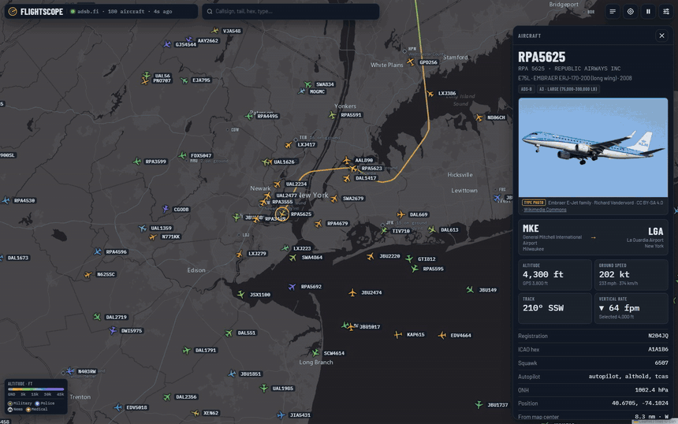
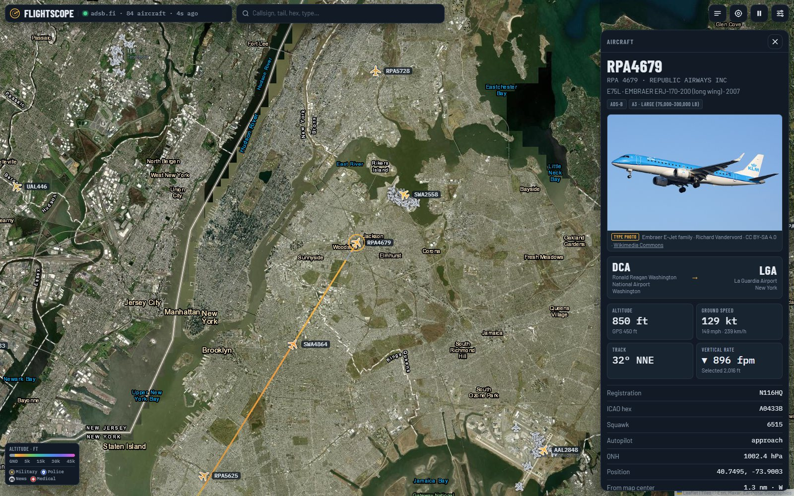
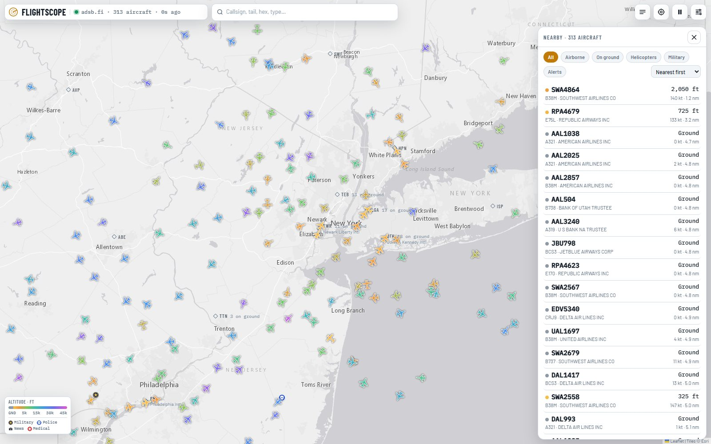
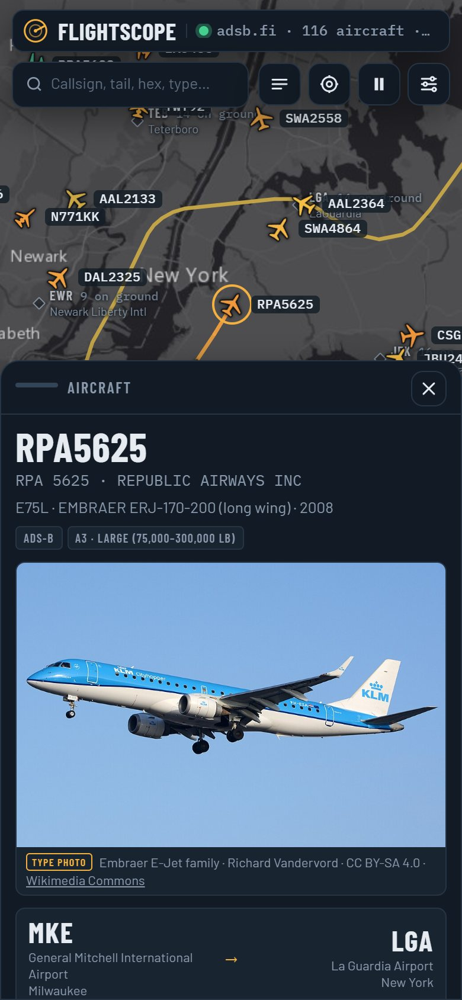

# FlightScope

A live flight radar for your browser: every aircraft the open ADS-B networks can see, gliding across a map coloured by altitude. Pick one for its photo, route, speeds, autopilot settings and the path it has flown. One HTML page and a small Node relay, refreshed every **5 seconds**, with no API key, account or dependencies.



Live data over New York, recorded from the running app and played at 30× speed. [Watch the video](docs/demo.mp4) · [Full screenshot](docs/demo.jpg).

## Install

Download the project with **Code → Download ZIP** and extract it. Install [Node.js 18 or newer](https://nodejs.org/) if needed, then:

- **Windows:** double-click **FlightScope.cmd**. For a desktop icon with the radar artwork, open a command prompt in the folder and run `FlightScope.cmd shortcut` once.
- **macOS / Linux:** open a terminal in the extracted folder and run:

```sh
node flightscope-server.js
```

Your browser opens at **http://localhost:8787**, or open it yourself on macOS and Linux. The map asks for your location and opens there, zoomed to roughly the view from **2,000 ft** up; **Settings → On launch** picks 10,000 or 35,000 ft, or keeps the map where you left it. Without permission it simply opens on New York or your last view.

## Updating

Download and extract the new version, or update a clean Git checkout with:

```sh
git pull --ff-only
```

Then restart the relay: **FlightScope.cmd** stops the old one and starts the new one, or press **Ctrl+C** and run `node flightscope-server.js` again. Changes to the page alone only need a browser refresh.

## Where the data comes from

The feeds refuse requests made directly from a web page, so the page talks to the relay on your computer, which fetches for it.

| Source | Used for |
| --- | --- |
| [adsb.fi](https://adsb.fi) | Aircraft positions, first choice |
| [adsb.lol](https://adsb.lol) | Positions when adsb.fi is unavailable; route lookups with [adsb.im](https://adsb.im) |
| [airplanes.live](https://airplanes.live) | A third position source |
| [The OpenSky Network](https://opensky-network.org) | Last-resort positions, and the flight history drawn behind the selected aircraft |
| [Planespotters.net](https://www.planespotters.net) | A photo of the exact airframe |
| [Wikipedia](https://www.wikipedia.org) and [Wikimedia Commons](https://commons.wikimedia.org) | A photo of the type when no airframe photo exists |
| Esri, [OpenStreetMap](https://www.openstreetmap.org/copyright), [RainViewer](https://www.rainviewer.com) | Basemaps and the rain radar overlay |

If one position source fails, the next takes over and the map keeps gliding; the status line says **retrying** while it waits.

## Reading the map

- **Colours** show altitude, from grey on the ground through orange, green and blue to violet at the highest levels. The legend at the bottom left has the scale.
- **Shapes** show the kind of aircraft: airliner, business jet, light plane, helicopter, fighter, military jet or turboprop transport, or ground vehicle. About **430** type codes are mapped.
- **Badges** mark military, police, news and medical flights, judged from the registry owner and callsign. Emergency squawks **7500 / 7600 / 7700** get a pulsing ring.
- **Trails** are drawn only for the selected aircraft: its OpenSky history back to the first position of the flight, joined to what this session has seen.
- **The details panel** shows the photo, origin and destination, altitude, ground speed, track, vertical rate, selected altitude and heading, squawk, wind, temperature, signal and accuracy. **Follow** keeps it centred; **Share** makes a link that opens on it.
- **The list** shows the nearest aircraft, with filters for airborne, on ground, helicopters, military and alerts, six sort orders, and search by callsign, registration, hex, type, operator or squawk.
- **Airports** appear as diamonds with an **N on ground** count while ground traffic is hidden; zoom in to level 11 or closer to see the aircraft on the ramp.

| Satellite map | Nearest list |
| --- | --- |
|  |  |

## On your phone



To use FlightScope on a phone at home, put `HOST=0.0.0.0` in a `flightscope.env` file next to the relay and restart it. Then open `http://<your computer's address>:8787` on the phone and choose **Add to Home Screen**. It installs as a full-screen app with its own icon, and the details panel becomes a bottom sheet.

Location needs https, so on a home-network address the map opens at its last view instead. The `ios/` folder holds a native iPhone wrapper, still uncompiled; see [its notes](ios/README.md).

<br clear="right">

## Options

Put these in `flightscope.env` next to the relay, one `KEY=VALUE` per line, or set them as environment variables:

| Variable | Default | Changes |
| --- | --- | --- |
| `FLIGHTSCOPE_CONTACT` | a placeholder | A way for the data providers to reach you, sent in the User-Agent. Planespotters asks for one. |
| `HOST` | `127.0.0.1` | `0.0.0.0` also serves the map to other devices on your network |
| `PORT` | `8787` | The relay's port |
| `OPENSKY_CLIENT_ID`, `OPENSKY_CLIENT_SECRET` | none | An [OpenSky API client](https://opensky-network.org/my-opensky) for more flight-history lookups than the anonymous ~400 a day |

`flightscope.env` can hold secrets, so it is git-ignored. Everything else lives in the **Settings** sheet: refresh interval, search radius, trail length, map style (dark, light, satellite, streets), units, labels, airports, range rings, rain radar and the launch view.

## What leaves your computer

There are no accounts, ads, analytics or tracking, and the relay listens only on `127.0.0.1` unless you change `HOST`. To fill the map, the page sends the centre and radius of the view to the relay, which forwards them to the position sources. Selecting an aircraft sends its identifier for the route, photo and history lookups. Map tiles load straight from their providers. Your location is used in the browser to place the map; the position itself is not sent anywhere. Settings, the last view and a small cache of type photos stay in the browser's local storage. [Privacy details](PRIVACY.md).

The images in this repository were captured from the running app with live public data over New York. Every aircraft photo in them is a Wikimedia Commons type photo, credited in the panel. [Image details](docs/assets.md).

## Other ways to run it

- **Cloudflare Worker:** `node flightscope-server.js --build-worker` writes `flightscope-worker.js`, the same relay with the page built in. Since November 2026 the position sources refuse Cloudflare's shared addresses, so a Worker shows the map without aircraft; run the relay on a home connection instead.
- **iPhone app:** the SwiftUI wrapper in `ios/` adds native location, sharing, haptics and quick actions. It needs a Mac with Xcode and the relay on an https address. [App Store checklist](ios/APP-STORE-CHECKLIST.md).

## Developing

No install or build step. The relay reads `flightscope.html` from disk on every request, so page edits show on the next refresh; changes to `flightscope-server.js` need a restart. After either, regenerate the Worker with `--build-worker`; after changing the icon code, redraw `FlightScope.ico` with `--build-icon`. [CLAUDE.md](CLAUDE.md) documents the architecture, the feed quirks and the decisions behind them. There are no automated tests yet; each change is checked in a real browser.

## License and credit

[MIT](LICENSE). [Leaflet](https://leafletjs.com) draws the map. Aircraft data belongs to the networks above and their volunteer feeders; OpenSky's data is for non-commercial use. Photos are credited in the app. FlightScope is independent and not affiliated with any of these services.
